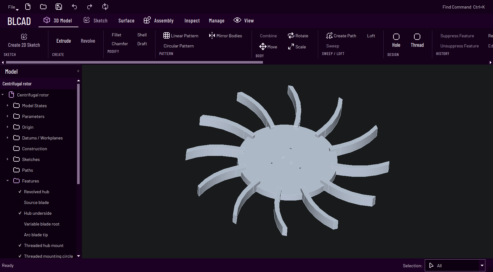
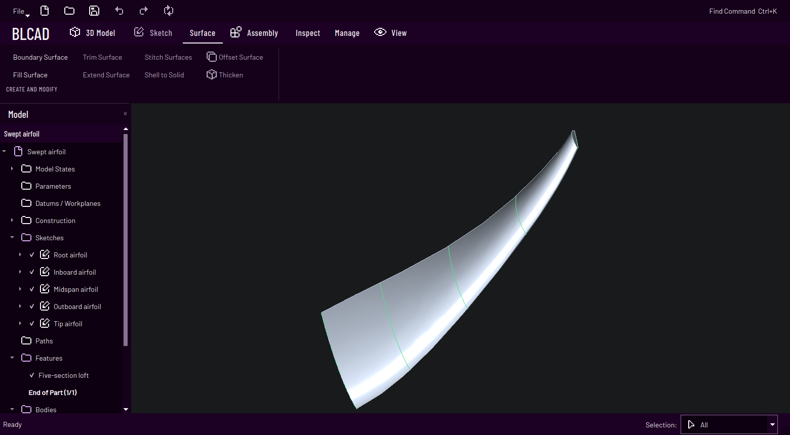

<p align="center">
  
</p>

<p align="center"><strong>Open-source parametric CAD for Linux</strong></p>

<p align="center">
  <a href="#gallery">Gallery</a> · <a href="examples/showcase/">Example models</a> · <a href="#run-blcad">Run BLCAD</a> · <a href="docs/mvp-plan.md">Roadmap</a>
</p>

## Gallery

### Planetary stage

<a href="docs/images/showcase/planetary-stage.webp"></a>

Three planet gears between a sun and an internal ring, with stepped hubs and a sixteen-hole mounting flange. [Model file](examples/showcase/planetary-stage.blcad.json)

<table>
  <tr>
    <td width="50%" valign="top">
      <strong>Centrifugal rotor</strong><br>
      <a href="docs/images/showcase/centrifugal-rotor.webp"></a>
      Twelve curved blades around a revolved hub with threaded mounting holes and an engraved blade count. <a href="examples/showcase/centrifugal-rotor.blcad.json">Model file</a>
    </td>
    <td width="50%" valign="top">
      <strong>Swept airfoil</strong><br>
      <a href="docs/images/showcase/swept-airfoil.webp"></a>
      A blade that tapers, sweeps and twists along five spline sections. <a href="examples/showcase/swept-airfoil.blcad.json">Model file</a>
    </td>
  </tr>
</table>

### Loft in progress

<a href="docs/images/showcase/loft-workbench.png"></a>

## What you can model

- **Parts** with constrained sketches, extrudes, revolves, sweeps, lofts, holes, threads and patterns.
- **Curves and surfaces** with 3D sketches, guided lofts, trims and thickening.
- **Assemblies** with joints, motion, interference checks and configurable part states.
- **STEP workflows** with import, direct face edits and export for parts and assemblies.

BLCAD is in active development. See the [roadmap](docs/mvp-plan.md) for current feature coverage.

## Run BLCAD

Install the [Linux build dependencies](docs/development-setup.md#install-dependencies), then build and run the Qt desktop.

```sh
cmake --preset dev-gui
cmake --build --preset dev-gui --target blcad_app
./build/dev-gui/blcad
```

Open a model from the gallery with **File → Open**. The [development guide](docs/development-setup.md) covers headless builds and tests.

[Project goals](docs/project-goal.md) · [Architecture](docs/architecture-summary.md) · [File format](docs/file-format.md) · [License](LICENSE)
