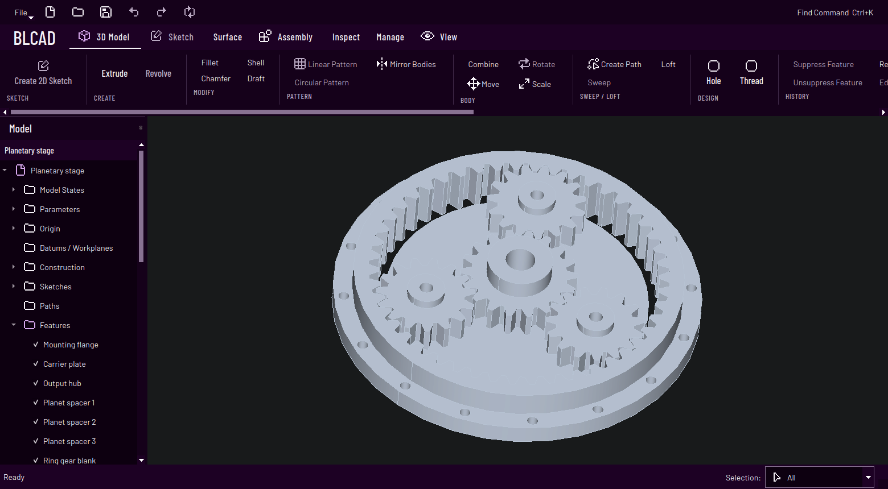
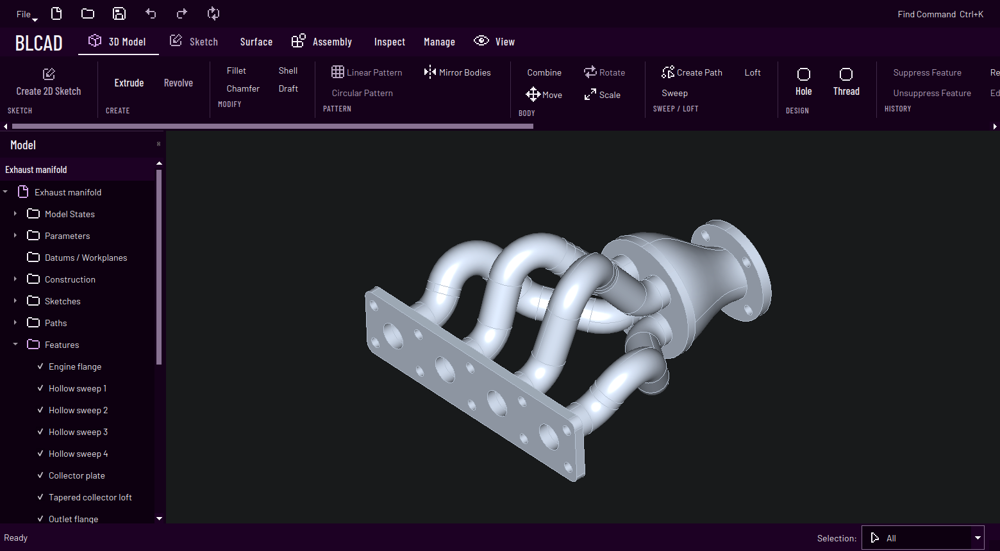
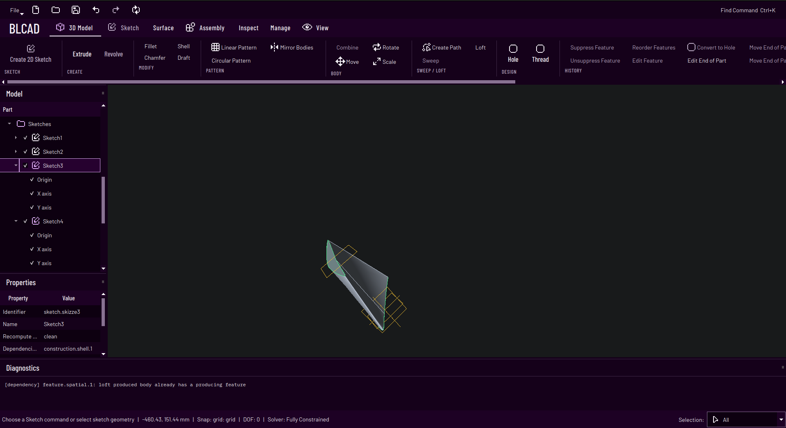
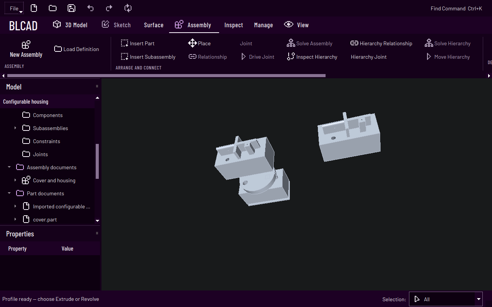

<p align="center">
  
</p>


## Gallery

### Planetary stage

<a href="docs/images/showcase/planetary-stage.webp"></a>

Three planet gears between a sun and an internal ring, with stepped hubs and a sixteen-hole mounting flange. [Model file](examples/showcase/planetary-stage.blcad.json)

### Exhaust manifold

<a href="docs/images/showcase/exhaust-manifold.webp"></a>

Four short hollow sweeps turn up from a scalloped engine flange into a compact lofted collector and a rectangular turbo flange. [Model file](examples/showcase/exhaust-manifold.blcad.json)

### Swept airfoil

<a href="docs/images/showcase/swept-airfoil.webp"></a>

A blade that tapers, sweeps and twists along five spline sections. [Model file](examples/showcase/swept-airfoil.blcad.json)

### Loft in progress

<a href="docs/images/showcase/loft-workbench.png"></a>

## What you can model

[Sketch & drive](#sketch-and-drive) · [Build & finish](#build-and-finish) · [Shape curves & surfaces](#shape-curves-and-surfaces) · [Assemble & inspect](#assemble-and-inspect) · [Work with STEP](#work-with-step)

### Sketch and drive

- **Start on a plane or part face.** Draw lines, arcs and splines, project existing edges into a sketch, and use geometric constraints and dimensions to define the profile. See the remaining degrees of freedom as you work. [Sketch solver](docs/sketch-planar-constraint-solver-mvp8.md)
- **Drive geometry with named parameters and unit-aware formulas.** Change a dimension in the parameter table and recompute the features that depend on it. Use model states for variants with their own parameter values, suppressed features or material assignments. [Parameters and model states](docs/parameter-model.md)

### Build and finish

- **Turn profiles into parts.** Extrude or revolve a section, sweep it along a path, or loft between sections. Work with multiple bodies and combine them with join, cut and intersect operations. [Interactive modeling](docs/user-interface.md)
- **Add mechanical detail.** Round edges with fillets, chamfer corners, shell bodies and draft faces. Drill bolt patterns, counterbores and countersinks, and add modeled or cosmetic threads where supported. Reuse detail with linear and circular patterns or mirrors. [Hole and Thread](docs/hole-wizard.md)
- **Add structure and markings.** Create ribs and webs from sketches, or emboss and engrave text on supported faces. [Rib, Web, Emboss and Engrave](docs/gui-sketch-driven-features-mvp9.md)
- **Revisit a design as it evolves.** Edit an earlier feature, suppress a step for a trial, or move the end-of-part marker to inspect an intermediate result. Preview edits before applying them. Use **Ctrl+K** to find commands by name. [Desktop workflow](docs/user-interface.md)

**Open the exhaust manifold** to explore four hollow sweeps, a lofted collector and the machined openings at each flange. [Editable manifold](examples/showcase/exhaust-manifold.blcad.json)

### Shape curves and surfaces

- **Route geometry in 3D.** Build spatial paths from lines, arcs, splines, helices or supported equation curves. Sweep a solid or surface along a path, or carry an annular profile along it to keep the passage open. [Spatial Sweep](docs/part-sweep-3d-geometry-mvp6.md)
- **Build smooth transitions and finish surface patches.** Loft across several sections, add guide curves and use the supported tangency and curvature controls. Create boundary and fill surfaces, trim or extend patches, and use offset, thicken or stitch operations to develop the final shape. [Guided Loft](docs/part-guided-loft-geometry-mvp6.md) · [Surface tools](docs/part-surface-feature-intent-mvp6.md)

**Open the airfoil** to see how five angled spline sections produce a blade that tapers and twists toward the tip. [Editable airfoil](examples/showcase/swept-airfoil.blcad.json)

### Assemble and inspect

- **Position parts and give them motion.** Place repeated components and nested subassemblies, align them with mates and inserts, and drive supported joints such as a hinge or a slide. Save named positions and visibility views to review the same assembly in different configurations. [Assembly tools](docs/assembly-system.md)
- **Fit parts in context.** Edit a part or sketch with the assembly around it, use directed design references for supported adaptive rebuilds, and create coordinated holes across selected components. [In-context editing](docs/parameter-model.md#in-context-part-editing-and-root-publication--198) · [Assembly machining](docs/hole-wizard.md#coordinated-project-machining--196197)
- **Check the result before sharing.** Measure geometry, evaluate mass and center of mass from assigned materials, and check contact, clearance and interference in supported assembly configurations. [Inspection and analysis](docs/gui-analysis-step-export-workbench-mvp7.md)

**Open the revolute joint project** to see how the hinge connects the parts. [Editable joint project](examples/revolute_joint.blcad.project.json)

<details>
<summary>See a configurable housing in the Assembly workbench</summary>



</details>

### Work with STEP

- **Bring in supplier parts and assemblies.** Load a STEP file as a linked reference or import it as an editable body for supported downstream operations. [STEP import modes](docs/step-import-sequence-mvp10.md#user-visible-import-modes)
- **Make changes to existing geometry.** On supported faces, use Direct Edit to move, rotate, resize or delete and heal a face. Keep the edit in the part history before exporting. [Direct Edit](docs/part-direct-edit-mvp6.md)
- **Send out the geometry you need.** Export a part, a posed assembly, or a structured STEP assembly. Headless tools are available for recompute, exchange and assembly analysis. [Structured STEP](docs/assembly-structured-step-products-mvp5.md) · [Headless tools](docs/development-setup.md#headless-tools)

## Run BLCAD

Install the [Linux build dependencies](docs/development-setup.md#install-dependencies), then build and run the Qt desktop.

```sh
cmake --preset dev-gui
cmake --build --preset dev-gui --target blcad_app
./build/dev-gui/blcad
```

Open a [gallery model](examples/showcase/) with **File → Open**. BLCAD is in active development. The [roadmap](docs/mvp-plan.md) tracks completed and planned work, and the [development guide](docs/development-setup.md) covers headless builds and tests.

[Project goals](docs/project-goal.md) · [Architecture](docs/architecture-summary.md) · [File format](docs/file-format.md) · [License](LICENSE)
