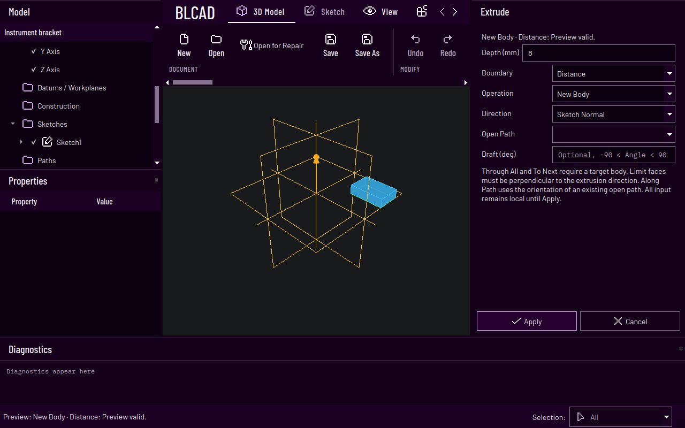
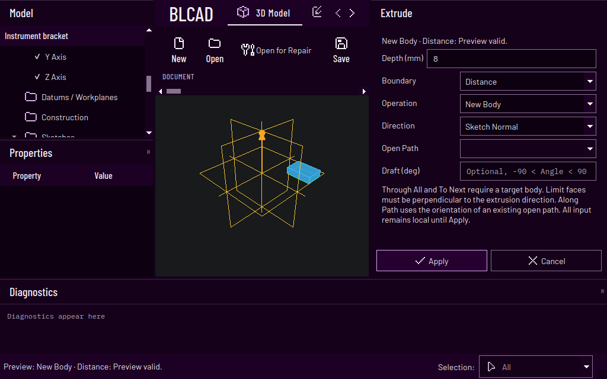
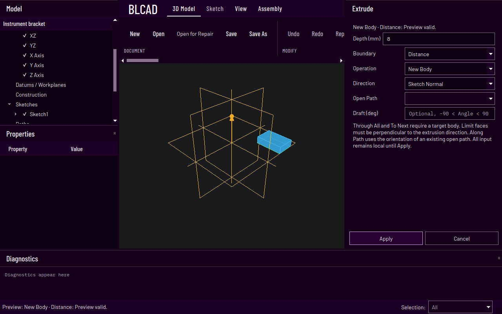
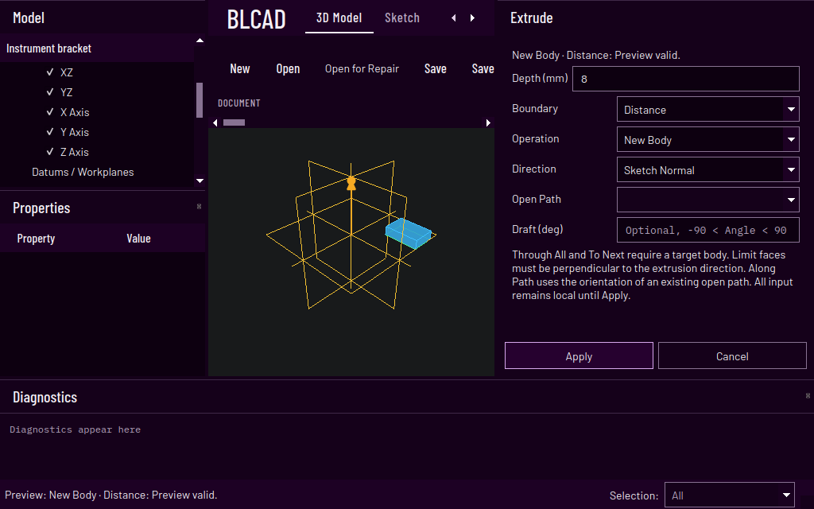
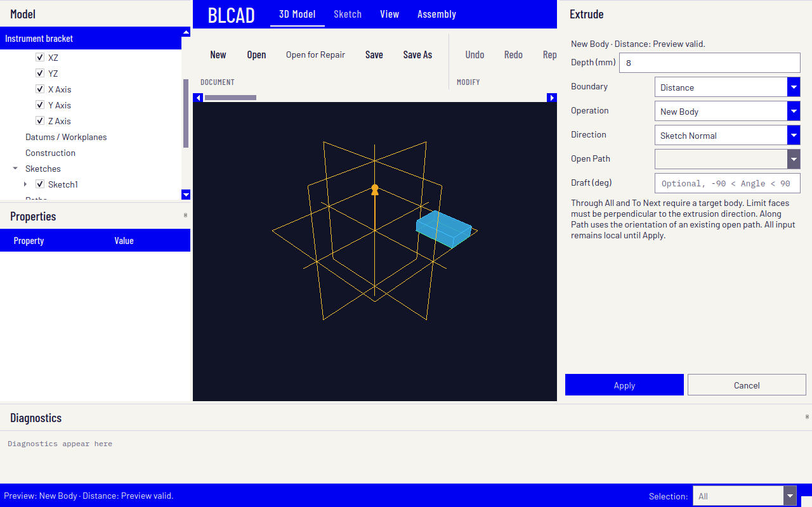
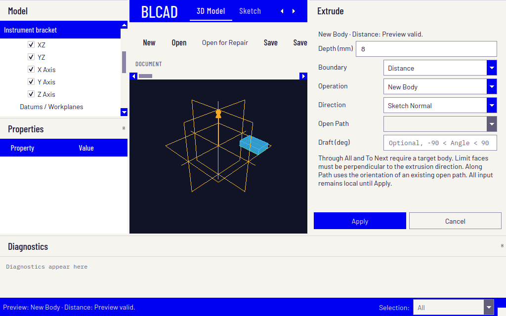

# Desktop design, dark-violet palette and icons

Reference: [Hermes Agent](https://hermes-agent.nousresearch.com/), inspected 2026-10-26.
The reference contributed the desktop's typography, spacing and lightly divided sections. The
2026-10-27 color-only follow-up replaces electric blue and paper panels with the user's dark-violet
to black reference palette. Layout, widget geometry, typography, labels and interactions remain
unchanged. The startup splash is restored verbatim from the parent of redesign commit `b6e4f68`.
The 2026-10-28 follow-up adds a curated Pixelarticons subset to the existing shell, retaining labels
and text-only fallbacks for CAD functions without a representative symbol.

## Implementation plan and acceptance

| Phase | Deliverable | Acceptance | Status |
| --- | --- | --- | --- |
| 1. Define the system | Palette, typography, spacing and state roles below | One documented contract; no unlicensed reference assets | Complete |
| 2. Build the foundation | Shared Qt palette/QSS and bundled desktop fonts | Offline font loading, readable controls, visible hover/focus/disabled states | Complete |
| 3. Redesign the shell | Identity/navigation bar, lighter ribbon groups, browser/properties/task panels and compact diagnostics | Commands reachable at 1280×800 and compact 1024×640; same action IDs and shortcuts | Complete |
| 4. Finish all workspaces | Matching task actions, viewport overlays, menus, tables, dialogs and startup screen | Sketch, Part, Surface and Assembly follow the same visual roles | Complete |
| 5. Exercise real workflows | Render/state checks plus combined authoring/editing/history/Save/Open tests | Offscreen and native Qt/OCCT pass; capture and inspect multiple window sizes | Complete |
| 6. Publish | Final evidence, reviewed commits, normal protected-branch PR merge | Tested source matches main; clean working tree | Delivery through the normal PR merge gate |

Phases run in order. Existing modeling authority, persistence, selection IDs and undo semantics remain
with their existing owners. This is a desktop design follow-up; Block 137 remains complete and the
Block-138 STEP reader remains planned.

## Visual system

| Role | Value / rule |
| --- | --- |
| Identity/navigation, menus and headers | Dark violet `#1d0124`, light foreground |
| Desktop/panels | `#15011a`, input/list surface `#0d0010` |
| Main text | Off-white `#f5f1f7` |
| Secondary text | Muted lavender `#b9a9c2`, at least 4.5:1 on the dark surfaces |
| Quiet separators | `#3f2948`; existing one-pixel rules at group boundaries |
| Interactive field edges and scroll thumbs | `#887292`, at least 3:1 against panels |
| Hover / selection / primary actions | `#22012a` hover; `#26012f` selection/primary fill with light text and lavender edges |
| Selected text in editors | Light lavender `#d7a8ed` background with dark `#0d0010` text |
| Accent / checked indicators | Light lavender `#d7a8ed` for readable titles, focus, control edges and checked indicators |
| Focus | Explicit contrasting outline, independent of hover and selection |
| Disabled | Muted readable text; arrow cells `#19011f`; existing disabled-state rules |
| Modeling canvas | Solid charcoal gray `#181a1b`, retaining distinct CAD geometry/selection colors |
| Tooltips | Near-black `#040005` with light text |
| Startup splash | Original Archimedes artwork, italic white serif title, white progress line/marker and centered `LOADING` on black |
| Display typography | Bundled Barlow Condensed Medium for identity, navigation and section headings |
| UI typography | Bundled Barlow Regular/Medium, readable at ordinary CAD control sizes |
| Numeric typography | Bundled IBM Plex Mono for editable scalar values and technical readouts |
| Spacing | Four-pixel base; 8/12/16-pixel control/group rhythm, compact ribbon commands |
| Geometry / effects | Square corners, solid fills, no gradients or decorative drop shadows |

The typography assets are original font files from the official Google Fonts repository with their
SIL OFL licenses and exact source/checksum manifest in `assets/gui/fonts/`. No Hermes logos, artwork
or commercial/trial fonts are copied. The existing BLCAD startup artwork remains its own asset.
The upstream license bytes include original line endings and trailing spaces; `.gitattributes`
preserves these three license files verbatim and scopes whitespace-check exemptions to them.
Authored sources and documentation retain the repository's normal formatting checks.

## Icon system

[Pixelarticons](https://github.com/halfmage/pixelarticons) 2.4.2 is pinned to commit
`c9ecc2da61afde85dbe539025e3d931c6152ad75`. The 65 selected public MIT-licensed SVGs, original license,
lossless 24px XPM masks and checksums live in `assets/gui/pixelarticons/`. All resources are local;
the QtGui-only renderer needs no SVG plugin or runtime download. Regeneration is documented there.

The explicit catalog supplies representative symbols for file/history actions, common editing,
selected Sketch shapes/constraints/dimensions, body transforms, parameters, references, exchange,
navigation and typed model-tree entries. Generic symbols are shared where the meaning is the same.
Specialized CAD operations such as Extrude, Revolve, Loft and fillets retain their text. Unknown
actions, feature/joint types and Sketch record families receive no guessed substitute.

Large ribbon commands retain icons above their labels. Mapped compact commands keep labels beside
24px icons, with two-pixel vertical padding inside the existing ribbon height and horizontal scroll
surface. Workspace tabs and their overflow arrows use the same icon family. Context shortcuts use
icons with their original text as tooltip/accessibility label; unsupported shortcuts remain text.
Task buttons, relevant choices, visibility menus and model-tree entries share the same catalog.
Normal, active/checked and disabled states use the documented text/accent/muted colors. Pixel masks
retain hard edges at native and fractional display scales. Action IDs, callbacks, labels, shortcuts,
selection metadata, persistence and modeling authority remain with their existing owners.

## Interaction and verification boundaries

- Selection, hover, keyboard focus, checked and disabled states remain distinguishable.
- Inputs, combo/spin arrows, checkboxes, menu branches and scrollbars remain visible on dark surfaces.
- STEP source checksum readouts must show the complete wrapped SHA-256 text without their own
  horizontal or vertical scrolling at 1280×800. Their height must include the polished font,
  document margins and the actual styled frame/padding.
- The ribbon keeps horizontal scrolling for long command groups; labels are not renamed for styling.
  Workspace tabs have explicit previous/next buttons when space is limited. Their reserved control
  slot keeps both arrows inside the header during native resize; pixel, containment and actual
  mouse-hit tests verify that the last workspace remains reachable.
- Dark-canvas dimensions and manipulators use coordinated readable dark badges and light text.
- Diagnostics remain available without taking most of the initial modeling canvas.
- The canvas permits a 360×260 logical-pixel minimum; the combined task workflow checks a compact
  1024×640 window as well as the ordinary and larger layout, bounded to the native available desktop.
- Render checks inspect actual widget pixels and contrast, not only stylesheet strings.
- Combined workflows cover Rapid Dimension, sketch completion/re-entry, feature preview/cancel/apply,
  visibility, Undo/Redo, Save/Open and existing Part/Surface/Assembly commands at native sizes.
- Source edits, builds, GUI runs and separate startup remain serial per `development-setup.md`.

## Pixelarticons follow-up verification (2026-10-28)

All five GUI-preset targets were built after the final catalog review. Final verification:

| Check | Cases | Assertions | Result |
| --- | ---: | ---: | --- |
| Full offscreen GUI | 574 | 75,457 | 554 passed; 20 expected native-only skips |
| Native Qt/OCCT icons, appearance, splash, ribbon, viewport, context/task tools and combined modeling/file workflows | 82 | 23,487 | Passed; no skips |
| Native icons/appearance/splash/combined workflow at 150% | 9 | 1,469 | Passed; no skips |
| Separate native application startup | — | — | Ran until intentional six-second timeout, exit 124 |

The new four-case icon proof covers bundled masks/license hashes, exact state colors and display
scaling, action labels/callbacks/shortcuts, a dynamically labeled Repeat command, typed browser
metadata and deliberate text fallbacks, including axes and arc records.

All 65 vendored SVGs and the MIT license match the pinned upstream archive byte for byte; all SVG
and mask SHA-256 values match the manifest. No build or runtime dependency was added.
`startup_splash.cpp` still matches `b6e4f68^` exactly. Numbered feature status is unchanged.

Native captures were inspected at ordinary and compact sizes and at 150% scaling for command
labels, tab navigation, task actions, browser entries and pixel edges. The clear native canvas
pixel `(400, 200)` remains exactly RGB `(24, 26, 27)`. The available X11 visual emits the known OCCT
Medium depth/stencil warning; final native/scaled/startup logs contain no High-severity,
BadDrawable or BadWindow errors.

All 877 source/test/asset/build-definition files in
`/tmp/blcad-pixelart-source-freeze-delivery.json` remained unchanged through the final full GUI,
native, scaled and startup runs. Logs are
`/tmp/blcad-pixelart-{build-delivery,gui-delivery,native-delivery,native-150-delivery,startup-delivery}.log`.
Reproduction commands are in `development-setup.md`.

Native feature preview with the curated icons at 1280×800:

The same task at 1024×640:

## Color-only follow-up verification (2026-10-27)

All five GUI-preset targets were built. Final verification:

| Check | Cases | Assertions | Result |
| --- | ---: | ---: | --- |
| Full offscreen GUI | 570 | 74,778 | 550 passed; 20 native-only skips |
| Focused native Qt/OCCT appearance, splash, ribbon, dimensions, Measure and combined modeling/file workflows | 36 | 5,970 | Passed; no skips |
| Native appearance/splash/combined workflow at 150% | 5 | 791 | Passed on unchanged repeat |
| Separate native application startup | — | — | Ran until intentional six-second timeout, exit 124 |

The stylesheet comparison confirms identical non-color declarations, including fonts, padding,
spacing, sizes and border widths/styles. `startup_splash.cpp` matches `b6e4f68^` byte for byte.
The appearance proof inspects actual rendered text-selection pixels and their contrast, as well as
field edges, pressed/checked/disabled states, placeholders, arrows and compact tab navigation.

The first sandboxed focused offscreen run passed the appearance/splash checks but could not read the
published STEP output at the end of the combined workflow; the final full offscreen and native runs
passed with normal filesystem access. The first 150% run missed a Rapid Dimension hover candidate
before authoring; all appearance/splash cases passed, and an unchanged repeat passed all five cases. No
interaction code or test input was modified to address either environment-sensitive result.

Native captures for controls, Sketch, feature tasks, Measure, Assembly and the restored splash were
inspected at ordinary and compact sizes, including 150% scaling. The available X11 visual emits the
known OCCT Medium depth/stencil warning; final native/scaled/startup logs contain no High-severity,
BadDrawable or BadWindow errors. Reproduction commands are in `development-setup.md`.

All 737 source/test/asset/build-definition files in `/tmp/blcad-violet-source-freeze-final.json`
remained unchanged through the final native, scaled, startup and full offscreen runs. Logs are
`/tmp/blcad-violet-{build-final,gui-full,native,native-150-retry,startup}.log`; the initial sandboxed
focused log and first scaled attempt are retained separately. Numbered feature status is unchanged.

### Charcoal canvas follow-up (2026-10-27)

The subsequent user swatch changes only the modeling-canvas constant to `#181a1b`; both the native
OCCT view and offscreen fallback use it. All five GUI-preset targets were rebuilt. The existing
`[appearance],[gui][viewport],[hermes-design-workflow],[native-viewer-lifecycle]` selection passed
offscreen (10 cases, 879 assertions; one expected native-only skip) and natively (11 cases,
886 assertions; no skips). Both rendered previews have exactly RGB `(24, 26, 27)` at the clear canvas
pixel `(400, 200)`. Updated native captures below were inspected. Separate native startup reached
the intentional timeout (124), with no High-severity, BadDrawable or BadWindow errors.

The full-suite and scaled evidence above belongs to the initial palette commit `4b9a0b1`; this
single-color follow-up used focused rendering/viewport checks. Logs are
`/tmp/blcad-charcoal-{build,offscreen,native,startup}.log`. The 737 files in
`/tmp/blcad-charcoal-source-freeze.json` remained unchanged during native and startup verification.

Color-only native feature preview at 1280×800, before the icon follow-up:

The same unchanged layout at 1024×640:

## Combined PR integration verification — 2026-10-29

Integration with dimension interaction, Coincident closure, Cut diagnostics and the complete rotor
performance follow-up preserves the dark violet palette, `#181a1b` canvas, curated Pixelarticons and
byte-identical pre-redesign splash source. The viewport conflict retains measured badge picking and
selection layering while using the theme's accent/panel/text colors for ordinary badges.

All five GUI-preset targets built. The combined full checks passed: Core **549 / 17,217**, Geometry
**459 / 35,243**, offscreen GUI **569 passed / 20 native-only skips / 80,332 assertions**, and native
affected features plus required shell coverage **136 / 29,127**, without skips. A subsequent
test-only native dimension fixture adjustment passed focused offscreen/native input and the final
150% appearance/icons/splash/desktop/dimension suite (**16 / 3,209**, no skips). Separate startup
reached intentional timeout 124. The normal and 150% badge, original splash and 40-blade rotor
captures were inspected. Final native logs retain only the known Medium depth/stencil warning and
contain no High-severity, BadDrawable or BadWindow errors. The exact source-freeze boundary,
fixture adjustment and logs are recorded in `development-setup.md` and the dimension contract.
Historical isolated performance measurements were not rerun during this correctness integration.

## Historical redesign verification evidence

Final acceptance passed on 2026-10-26:

| Check | Cases | Assertions | Result |
| --- | ---: | ---: | --- |
| Full Core | 545 | 17,037 | Passed |
| Full Geometry | 452 | 31,557 | Passed |
| Full offscreen GUI | 566 | 73,433 | 546 passed; 20 native-only skips |
| Full canonical native GUI with all subsequent follow-up tags | 378 | 70,304 | Passed; no skips |
| Native design/workflow at 150% | 5 | 771 | Passed |
| Required shell coverage closure | 3 | 299 | Passed |
| Native STEP checksum/layout regression | 1 | 180 | Passed |
| Separate native application startup | — | — | Running until the intentional six-second timeout, exit 124 |

The new combined workflow authors a rectangle and driving Rapid Dimension, cancels and reapplies
an Extrude preview, edits the depth/name, verifies independent 4,800/7,200 mm³ solid volumes,
checks exact two-step Undo/Redo and canonical Save/Open, then exports STEP through the actual
ribbon/dialog controls. It verifies task action hits and browser/model selection at compact,
ordinary and larger window sizes. The expanded appearance cases inspect real rendered control
states, font registration, contrast, input arrows, placeholders and workspace-tab mouse navigation.

Native popup helpers await exact cursor/hover agreement over separate event turns, bounded to two
seconds and four pointer requests; strict row and actual-click assertions remain. Checksum heights
use polished font/document metrics and the style's frame-content rectangle. The existing native
STEP regression confirms both complete digests have zero internal scroll range.

All five GUI-preset targets were built. Builds, source edits, GUI runs and separate startup remained
serial. The 733 CMake/source/test/asset files in
`/tmp/blcad-hermes-source-freeze-final.json` remained unchanged through the final full GUI/native,
scaled and startup checks; Core/Geometry sources were unchanged by the final GUI-only fixes.
Final logs are `/tmp/blcad-hermes-{core-full,geometry-full,gui-full,native-full,closure}.log`,
`/tmp/blcad-hermes-native-150-final.log`, `/tmp/blcad-hermes-step-style-native.log` and
`/tmp/blcad-hermes-startup-final.log`. Commands and the canonical native filter extension are in
`development-setup.md` and `gui-shell-acceptance-mvp9r.md`.

Native captures in `/tmp/blcad-hermes-native/` and `/tmp/blcad-hermes-native-150/` were inspected
for Sketch, feature preview/editing, Surface, Assembly, input/control states and startup. The available
X11 visual emits OCCT's known Medium depth/stencil warning; final native/scaled/startup logs contain
no High-severity, BadDrawable or BadWindow errors. No required check is unavailable.

Implementation and local acceptance are complete. Publication uses the repository's normal
protected-branch PR merge into `main`. The delivery gate requires comparing the tested branch tree
with `origin/main` after integration and a clean working tree. Numbered feature sequencing remains
Block 137 complete / Block 138 planned.

The versioned captures below show the original 2026-10-26 design, before the color-only follow-up.

Native Qt/OCCT feature preview at 1280×800:

The same live task at 1024×640, with visible tab navigation and reachable Apply/Cancel:

