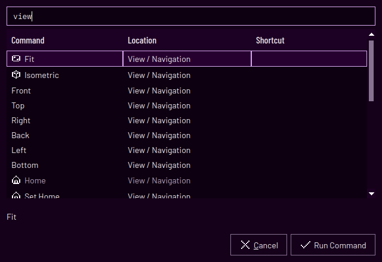
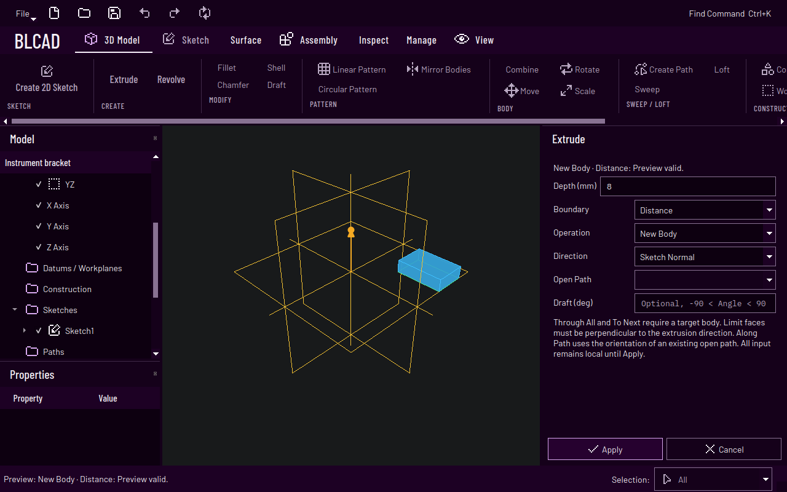
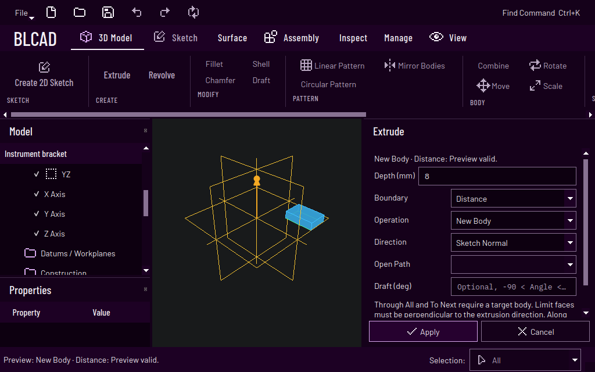

# User Interface Architecture

The current desktop is `ShellWindow` + `ShellRibbon` (`src/gui/shell/`). Core/Geometry,
transactions, browser semantics, selection and the OCCT viewport remain the authorities behind it.
Numbered acceptance through STEP Import Block 143 and the current GUI revision are tracked only in
`mvp-plan.md`. Older block-specific sections below describe the underlying contracts; historical
MainWindow/widget names are not the current layout contract.

## Current desktop workflow — 2026-11-04

The layout follows Inventor's separation of a persistent command area, model browser, central
canvas and contextual property/task panels. Reference: Autodesk's [Inventor UI guidelines](https://forums.autodesk.com/autodesk/attachments/autodesk/inventor-programming-ilogic-forum-en/110509/1/Inventor-UI_Guidelines.pdf),
[model browser](https://help.autodesk.com/cloudhelp/2026/ENU/Inventor-Help/files/GUID-EDF6B951-C309-44A8-868C-B72D99F6D5A7.htm)
and [property panels](https://help.autodesk.com/cloudhelp/2022/ENU/Inventor-Help/files/GUID-3E5505B9-9F60-43A0-BF32-97D183B91A70.htm).
This is a BLCAD implementation using its existing fonts, icon catalog and dark-violet colors; no
Autodesk assets or unsupported commands are introduced.

The ribbon sits above **all** docks at full window width. The browser and selected-object properties
occupy the left, geometry the center, and the active task the right. Inputs scroll within tasks while
Apply/Cancel remain with their existing owners. Empty Diagnostics is initially hidden; reported
errors reveal it. View > User Interface toggles the supporting panels and Reset Layout restores
their positions without changing the document, viewport camera, selection or active task.
The active ribbon tab, chooser query and dock layout are transient UI state; they add no Part/Project
file-format fields or undo records.

| Surface | Commands and workflow |
| --- | --- |
| File | New Part, New Assembly, Open, Open for Repair, Save, Save As |
| Quick Access | New, Open, Save, Undo, Redo and Repeat, accessible from every ribbon context |
| 3D Model | Plane/face → Create 2D Sketch; profile → Extrude/Revolve; finishing, patterns, Body operations, Sweep/Loft, construction, Sketch3D and Hole |
| Sketch | Finish/Cancel where supported; draw, constrain, dimension, modify, transform, project, grid and diagnostics; enabled only during Sketch editing |
| Surface | Boundary, Fill, Trim, Extend, Stitch and Shell to Solid |
| Assembly | Assembly creation, placement, relationships, joints/motion and STEP sources |
| Inspect | Measure, Assembly analysis/exports and Sketch diagnostics |
| Manage | Part STEP export, Parameters, Reference Repair and STEP sources |
| View | Navigation, camera bookmarks, projection/display modes and recoverable supporting panels |

`Find Command` / **Ctrl+K** opens a keyboard-searchable command chooser. All actions supplied through
ribbon buttons, menu variants, File and Quick Access are explicitly registered; repeated presentations
of the same QAction appear once. Search is case-insensitive and matches every typed word against
command name and location. Results show location and shortcut. Unavailable commands remain visible
with a muted presentation and an explanatory hint; Run Command is disabled. Owner enablement changes
refresh the list while open. Enter or result activation runs only a currently visible, enabled action
in an enabled context; Esc cancels without a command. The chooser closes before switching to the
command's ribbon page and invoking its existing handler. No hidden selections, parameters, automatic
Apply or new transaction routes are created.



Typical Part flow remains: create/open → pick a plane or planar face → Create 2D Sketch → draw and
constrain → Finish Sketch → choose the profile operation → review preview and Apply/Cancel. Undo,
Redo and Save are reachable throughout that flow. Assembly and imported Reference/Editable workflows
retain their existing capability restrictions. A new arrangement does not broaden geometric support;
unsupported/ambiguous selections stay unavailable or fail with the existing diagnostic.

The layout tests (`[workflow-layout]`) and existing combined/native workflow proofs verify this
surface. Exact results and limitations live in `development-setup.md`; subjective discoverability and
future CAD capabilities are not inferred from automated coverage.

The UI is deliberately not built like FreeCAD. The goal is a modern, consistent, reduced interface
with clear separation between model, parameters, features, Sketch topology, solver results, and
Assembly. The UI operates Core/Geometry authorities; it must not own CAD or solver mathematics.

Native Qt/OCCT feature preview with the full-width command surface (1280×800):



The same preview at 1024×640 keeps Apply and Cancel reachable:



## Planned Inventor-like workflow contract

Planning request: 2026-11-06. This section is the shared UI target for
[Blocks 145–204](inventor-parity-sequence.md), a target whose delivered slices are recorded below.
The Block-144 layout above remains the shell baseline; Block 145 adds shared controls serially. Numbered status belongs to
`mvp-plan.md`; [UI01 and the combined test plan](inventor-parity-test-plan.md) own acceptance evidence.

The target closely follows Inventor's command organization, model-browser interaction and ordered
property-panel workflows, while retaining BLCAD's fonts, icons and dark-violet palette. Extend the
current full-width ribbon, persistent File/Quick Access, left browser, central OCCT canvas and
owned property/task panels. Keep task docking/floating recoverable, with the current right-hand
task location as the default. Do not replace the accepted shell or force a new window per feature.
Use Autodesk's [property panels](https://help.autodesk.com/cloudhelp/2026/ENU/Inventor-Help/files/GUID-3E5505B9-9F60-43A0-BF32-97D183B91A70.htm)
and [browser](https://help.autodesk.com/cloudhelp/2026/ENU/Inventor-Help/files/GUID-EDF6B951-C309-44A8-868C-B72D99F6D5A7.htm)
as workflow references. The detailed behavior below is BLCAD's planned implementation contract.

### Shared property panel behavior

Block 145A design (2026-11-06): extend `gui-feature-coverage-manifest-mvp9.json` additively with
`workflow_program`, leaving accepted historical family/shell records unchanged. Each unique
capability has an owner, contract and explicit planned/implemented disposition. Implemented entries
map actual shell action IDs to existing headless API declarations and separately registered headless
and native proof filters/sources. Planned entries carry descriptive future command names and no
implemented APIs/actions/proofs. The inventory is an audit, not runtime feature enablement or an
implementation-status authority. Catch2 validates schema/paths, uniqueness, registered nonhidden
proofs and source matches; negative fixtures reject fabricated implementation, unresolved/OR filters,
wrong sources and evidence on planned entries. The existing Extrude provides the first mapping.

The reproducible baseline measures the existing headless Extrude candidate's physical 20×10×8 mm
solid and canonical JSON invariance, using three fresh-session and ten reused-controller previews.
Fresh-session timing is not a cold-process benchmark. An explicitly requested artifact records
all raw samples, environment, source/runtime SHA-256 inventory and geometry/intent evidence;
it makes no latency guarantee. Existing native modeling/layout tests supply the unchanged UI
baseline at ordinary/compact sizes and 100%/150% scales. Slice 145B implements the property
controls below; breadcrumb behavior remains assigned to 145C. No file-format or Core change occurs.

Block 145B design (2026-11-06): `ShellPropertyGroup` provides a keyboard-toggleable heading,
owned content and a plain-text diagnostic that remains indicated in a collapsed heading.
`ShellPropertySelector` wraps an existing semantic-reference combo, exposes Pick/Clear and a
selection count, and delegates active picking to its existing command owner. It stores no model
identity or selection authority. Extrude adopts Input Geometry, Behavior and Advanced groups;
first/second limit-face selectors reuse its existing capability-filtered pick roles and overlays.
Clearing a required face invalidates Apply until explicitly reselected. Groups begin expanded to
preserve discoverability and existing command input paths; collapse is transient. The shared scalar
HUD row remains above these groups to preserve the common manipulator flow across feature families.
Field/group diagnostics use text as well as styling; changing modes clears obsolete diagnostics.
Ctrl+Enter is adopted first by Extrude and validates its displayed scalar input before applying;
invalid input cannot apply the previous value. Other feature families retain their existing keyboard
behavior until their own controls are migrated. Apply/Cancel stay outside scrolling group content.
No persistence change or nested Sketch editing is introduced; 145C owns that separate lifecycle.

Block 145C1 design (2026-11-06): the existing `GuiDocumentSession` gains
`begin_part_workflow()`, `publish_part_workflow(label)`, `cancel_part_workflow()` and
`part_workflow_active()`. Begin requires an idle, strict, fresh editable Part at a committed history
state, with no enclosing workflow. It snapshots the complete session, including both Sketch sidecar
catalogs and existing Undo/Redo.
The snapshot is immutable and shared only when the session itself is copied. Existing Sketch and
feature transactions operate on the disposable working session; there is no second solver/history
format. Local Undo/Redo cannot cross the workflow's entry state or expose pre-existing redo entries.
Document replacement/close are rejected until the workflow ends, even with discard requested.

Save/Save As while a workflow is active uses the committed entry snapshot through the existing
atomic main/constraint/dimension save transaction. The chosen path and saved-state metadata survive
Cancel. Dirty state describes committed unsaved work; the UI in C2 must also identify the active
draft. Failed saves preserve existing file/path state. Cancel restores the complete entry intent,
catalogs, selection, visibility, workspace and Undo/Redo branch, with monotonically newer model/
presentation revisions. Publication validates complete draft intent, both catalogs and downstream
geometry through `publish_part_state` on a copy of the entry session, then publishes once with one
Undo label. Failure leaves the workflow correctable; no intermediate history or files become
committed. Publishing unchanged intent is a no-op without an Undo entry. No Core/JSON/schema changes
are introduced. This API is initially headless and unused by Qt commands; C2 must wire ownership,
source revalidation, consumer/task guards and actual native breadcrumb/Create Another evidence
before the shared lifecycle can be claimed as implemented.

1. A compatible preselection starts the command with its first semantic input populated; command-first
   entry activates that selector. Input rows have labelled roles, selection counts, clear controls,
   active-state emphasis and matching canvas highlights. A valid second input never replaces the first
   because focus moved invisibly. Unsupported or ambiguous targets have an explicit reason.
2. Groups progress from input geometry to behavior, dimensions and advanced settings. Collapsible
   accordion groups expose required fields by default; collapsed invalid groups still show their
   error. Order-specific sections/rails/stations have visible add/remove/reorder controls.
3. Panel fields, dimensional HUD and model manipulators share one candidate value. Displayed formula
   parameters remain bound unless the user explicitly changes that binding. Units, signed directions,
   approximation limits and source revisions are visible where they affect a decision.
4. Breadcrumbs show feature, source Sketch and Assembly/Part edit context. A supported switch into a
   source Sketch suspends the feature candidate under the same owner; returning revalidates it against
   the changed source. Cancel restores the complete pre-command transaction. Unrelated nested tasks
   remain disallowed. Block 145 establishes this lifecycle before feature-specific adoption.
5. Preview visibility is explicit. Input highlighting remains available while a disposable result is
   shown. Errors identify the affected field/source and can be corrected without restarting. Apply
   becomes available only for a complete current candidate; stale jobs cannot enable it.
6. Keep Apply/Cancel outside the scrolling input region. Where meaningful, Apply/Create Another
   commits once and starts a fresh candidate with retained settings but no hidden target selections.
   Presets store compatible settings and revision-pinned catalog choices, never live document IDs.
7. Enter accepts the focused value; Tab/Shift+Tab moves focus; Ctrl+Enter commits a valid candidate.
   Existing command-specific Sketch completion keys retain their documented meaning. Escape cancels
   the active drag/input gesture first, then the complete task. No shortcut commits incomplete input.
8. Double-click in the browser edits the real persistent feature through the same panel. Context-menu
   Edit and in-model feature glyphs route through that same controller. Mode conversion is explicit;
   reordering/suppression and End of Part are separate commands with distinct Undo labels.
9. Ctrl+K indexes every delivered action and reports unavailability. Repeat remains available from
   Quick Access. Status/diagnostics name the feature and correction; error text alone does not replace
   input highlighting. Use text/icon as well as color for errors, selection roles and result status.

### Planned command placement and workflows

| Ribbon/context | Planned commands | Required workflow |
| --- | --- | --- |
| Model → Modify | Hole, Thread, advanced Fillet, Direct Edit | preselect face/edge → choose operation → dimensions/manipulators → preview → Apply; browser double-click edits the same intent |
| Model → Create | Rib/Web, Emboss/Engrave, improved Sweep/Loft | select sketch/profile/path/support roles in order → direction/mapping/continuity → preview → Apply |
| Sketch → Draw/Constrain | Equation Curve, Smooth/G2 | author formulas/domain or select compatible junction → check solved preview/DOF → commit → Finish Sketch |
| Model → 3D Sketch context | spatial curves, relations, dimensions and curve grips | choose spatial plane/axis locks → create/constrain → manipulate solved geometry → finish to path/Sweep/Loft |
| Surface → Create/Modify | Offset, Thicken, improved Loft, Trim/Extend and gap inspection | choose faces/quilt/boundaries → output and side/continuity → select kept region → validate gaps/thickness → Apply |
| Browser → history | Suppress/Unsuppress, Reorder, End of Part | preview dependent effects → validated complete-history update; prefix context always visibly labelled |
| Manage/properties | Materials, Model States and variant table | choose scope/state → edit typed assignments/overrides → preview complete affected model → one Apply |
| Assembly → relationships/design | Flexible occurrence, Edit Part in Context, adaptive references, coordinated Hole | choose occurrence/driver/participants → inspect root/Part context → solve/rebuild candidate → root transaction |
| Assembly → representations | model states, positions and design views | select the clearly labelled representation type → preview/activate → explicitly author/save changes to that type |
| Inspect | Physical Properties, finite Measure, Zebra, Curvature, Section, Thickness, Motion/Contact | choose actual scope → compute with visible units/precision/status → inspect overlay/copy → close |

For Hole, use the familiar top-to-bottom order: positions → target/direction → bore/seat type →
termination → thread → advanced checks. For Fillet, keep constant/variable/face/full-round as modes
of the same feature tool; highlight edge stations and face roles directly. Direct Edit exposes its
Move/Rotate/Size/Delete choice beside the existing triad and provides matching numeric fields.
In-context Assembly editing always shows the root and edited definition/occurrence in the breadcrumb.
An Assembly Hole participant table makes every affected Part and recipe visible before Apply.

### Interaction and layout acceptance

- Native tests use actual pointer/keyboard actions on the current `ShellWindow` and OCCT viewport.
  Check 1280×800, 1024×640 and 100%/150% scale, with real long names, formulas, diagnostics and lists.
- No required selector, validation message or completion action may be clipped or covered. Dock
  resize/reset/reopen must retain the candidate and meaningful focus without changing model intent.
- Verify preselection versus command-first equivalence, keyboard-only use, cross-highlights,
  breadcrumbs, multiple selectors, parameter/HUD binding, exact release, cancellation and repeated use.
- UI tests assert complete physical/transaction outcomes as well as enabled widgets. Captures are
  reviewed for visual correctness; controller coverage cannot substitute for visible usability.
- Keep current command locations and native regressions working during incremental delivery. New
  groups appear only when their actual headless capability and diagnostics are implemented.

## Main areas

| UI area | Purpose |
|---------|---------|
| 3D viewport | display and interaction with Parts, Sketches, faces, edges, axes, and Assemblies |
| Feature tree | chronological/logical feature list of a Part |
| Assembly tree | Parts, occurrences, relationships, and joints |
| Parameter window | parameter name, value, unit, formula, scope, and usage sites |
| Property panel | edit selected object/feature through validated commands |
| Command palette | quick access to Sketch, Part, Surface, Assembly, Inspect, and Exchange commands |
| Measure readout | transient distance, angle, radius/diameter, volume, solids, and witness overlay |
| Engineering panel | later technical assistants for mechanical engineering domains |

The Block-131 Measure command is an Inspect action over fresh derived Geometry. Point/edge/face and
Body picks produce a transient readout and optional witness overlay. Cancel, incompatible targets,
or stale Geometry produce no document mutation; Measure state is never serialized.

## Selection-first modeling workspace

Block 122 adds a second, model-context command surface over the accepted MVP-7 shell. The global
workspace row remains `Part | Assembly | Inspect | Exchange`; the modeling context row is:

```text
Part | Surface | Assembly | Selection filter | Repeat | ViewCube | Camera bookmarks
```

`GuiModelingWorkspace` owns transient command-selection state. `GuiModelingWorkspaceShellBinder`
rendered it through the stable Qt object names below until the Block-133 shell reset deleted it;
Block 136 re-establishes this surface on `ShellWindow`, and the names below are historical:

```text
blcad.modeling_toolbar
blcad.modeling_tabs
blcad.modeling_selection_filter
blcad.modeling_repeat
blcad.modeling_mini_toolbar
blcad.view_cube
blcad.camera_bookmarks
```

A semantic viewport/browser selection becomes a command source only when its verified capability
matches a command's first input. A Body can expose Boolean/Transform/Pattern/Mirror starts; an Edge can
expose Fillet/Chamfer; a materialized profile region can expose Extrude/Revolve/Sweep/Loft/path
Extrude. The UI does not infer capability from OCCT topology, display labels, or semantic-id spelling.

The mini-toolbar appears near the latest viewport click, orders commands deterministically, consumes
the selected object on command start, and exposes Cancel while the existing task state is active.
`Esc` and Cancel restore the complete semantic selection plus capability context. Repeat starts the
same command id without replaying hidden parameter or selection state.

Finish Sketch keeps the existing camera, cursor, workspace, and selection-filter restoration. A
single unambiguous bounded line region is materialized into the persistent Sketch before the feature
handoff; an already materialized profile is handed off unchanged. Multiple or ambiguous detected
regions still require an explicit contour/profile selection.

The selection-filter combo publishes one mask to both `GuiSelectionModel` and `OcctViewport`. The
ViewCube reuses viewport standard-camera authority; Home and named bookmarks store complete transient
camera snapshots and never enter Part, Project, sidecar, undo history, or exchange persistence.

Canonical contract: `docs/gui-modeling-workspace-mvp9.md`.

## Viewport manipulators and numeric HUD

Block 123 adds one common direct-manipulation surface for later Part, Surface, and Assembly commands:

```text
linear arrow | angular wheel | radial handle
translation triad | rotation triad
pattern count | pattern spacing
```

`GuiViewportManipulatorLayer` owns only transient handle descriptors, camera/model mapping, hit
products, pointer measurements, numeric text, and candidate values. It does not receive a
`GuiDocumentSession` and cannot mutate a feature, Body, component, relationship, joint, or save format.
The owning Block-124–130 command supplies handles and turns the returned candidate into its own
validated Geometry preview and Apply transaction.

Handle presentation has a fixed DIP size and tolerance, so arrows and rings remain visible across
zoom levels. Value mapping remains in model space: linear families use a model axis, angular/radial
families use an explicit model plane. Overlapping handle hits sort by screen distance and stable handle
id. Drag start freezes the initial measurement, avoiding a value jump to the visual endpoint, and
release evaluates the exact final pointer sample.

The deleted Qt overlay binder exposed the historical object names below; Block 135 re-establishes the
equivalent shell-owned `ShellFeatureTools` overlay without cross-component discovery:

```text
blcad.viewport_manipulator_overlay
blcad.manipulator_numeric_hud
```

Dragging updates the HUD. Valid typed `mm`, `deg`, or unitless count input updates the same candidate
and overrides later pointer motion until explicitly cleared. `Esc`, window deactivation, invalid
mapping, or invalid release clears transient interaction without a compensating document transaction.
In the Block-135 Extrude/Revolve shell, rejected text or an incompatible unit restores the last valid
displayed value. Cancelling only the active drag restores its drag-start value and keeps the feature
task open; a second `Esc` cancels the complete task. Selecting a non-profile object clears any prior
Finish-Sketch handoff, so commands never start from a stale hidden profile.

Canonical contract: `docs/gui-viewport-manipulators-mvp9.md`.

## Contextual Sketch workspace

Block 106 promotes planar Sketch editing to `GuiWorkspace::Sketch`, a transient contextual Part mode.
The global workspace row remains `Part | Assembly | Inspect | Exchange`; entering Sketch does not create
persistent project mode or Part feature.

Sketch command surface:

```text
Create | Constrain | Dimension | Modify | Project
```

Sketch browser contract:

```text
Entities | Constraints | Dimensions | Diagnostics
```

The command bar renders group strip/numeric HUD. Existing model browser remains semantic selection
authority and Properties/Tasks remains contextual task surface. Status bar exposes tool hint, raw plane
cursor coordinates, snap/inference, remaining DOF, and solve state.

Producer boundaries are explicit:

```text
Block 107  cursor / hover / hit / box selection / grid / snap / inference
Block 108  persistent shared SketchPointId / SketchTopology identity
Block 109  deterministic solve result / exact local remaining DOF / solver diagnostics
Block 110  semantic handles / live drag solve invocation / status publication / release commit
```

Block 109 provides the headless producer and Block 110 continuously publishes baseline/live drag
`SketchSolveResult` status and remaining DOF through the existing status row. The UI must render
`SketchSolveResult`; it must not count endpoints or glyphs to estimate DOF.

`Enter Sketch` captures workspace, semantic selection, full transient camera state, and viewport
selection filter. It resolves workplane, enters normal orthographic view, restricts picking to
SketchEntity/Edge/Vertex. `Finish Sketch` cancels unfinished creation previews and restores the
workspace, camera and selection filtering after validation. Open contours remain editable and do
not become profiles; invalid closed/branched contours and document errors reject completion. It does not
invent an Extrude or another downstream feature; the handoff publishes an existing profile or the
single bounded line region materialized as part of finishing the Sketch.

The command lifecycle is canonical in `docs/gui-interactive-sketch-workspace-mvp8.md`.

## Sketch transformations and helper geometry

The Transformieren editor is nonmodal. Select several curves by repeated clicks or a selection
rectangle, then drag in the canvas or enter numeric values. Move/Copy use a translation drag;
Rotate/Scale and circular patterns allow picking the center; rectangular patterns retain numeric
counts and the second direction. Offset accepts multiple disconnected line chains. Numeric values
and the live preview share one operation request; Apply creates one undo step, and Escape cancels.

Mirror and Symmetric expose separate Symmetrieachse and Elemente pick controls. Mirror copies the
selected curves across the picked line. Symmetric constrains existing curves in nearest reflected
pairs, including their endpoints and spline control points, while keeping the picked axis stationary
during authoring. A single selected line constrains its endpoints symmetrically. Existing dimensions
and constraints participate in the solve; conflicting edits cannot be applied.

Linie offers ordinary, dashed construction and dash-dot center lines in the sketch itself. Helper
lines can serve as axes and do not contribute to automatic profiles. The Spline tool collects any
number of fit points until right-click or Enter. Every click extends a smooth cubic Bezier chain
through the picked points; the preview remains transient until completion, which creates one undo
step. Clicking near the first point closes the chain exactly,
with a continuous tangent at the seam. Finish Sketch also commits a pending spline before leaving
the editor. Closed spline chains and mixed spline/line contours become selectable extrusion
profiles; construction and center lines do not participate in region discovery. The elliptical-arc
creation command is removed; exact rational ellipse spans remain available internally for ellipses
and projected curves.

## Sketch canvas interaction

Block 107 provides one mapping between Qt DIP, OCCT view rays, active-plane coordinates, and model
points. Hit/snap tolerances are DIP-based and remain zoom/high-DPI stable. Native mapping accounts for
device-pixel ratio; offscreen tests use deterministic orthographic mapping.

Hover/repeated-click priority:

```text
Point -> Curve -> Dimension -> Glyph
```

Repeated clicks at the same location cycle the stable overlapping-hit stack. Empty-space drag uses:

```text
left -> right   Window: fully contained curves
right -> left   Crossing: contained or crossed curves
```

A transparent overlay draws grid, highest-priority hover product, active snap marker, and rubber-band
selection, and dashed horizontal/vertical/alignment inference guides. These are transient view
products; since Block 134 the shell's sketch tool surface owns them.

Sketch menu exposes `Show grid` and `Snap to grid`. Default spacing is 10 mm with every fifth line
major. Visible grid range is bounded; visual subsampling never changes snap spacing.

Implemented snap/inference families:

```text
origin | axis | endpoint | midpoint | center | quadrant
intersection | nearest | grid
horizontal | vertical | X alignment | Y alignment
```

Eligible candidates are ordered by model-space distance, screen-space distance, stable family priority,
then candidate id. Status displays raw plane coordinates separately from selected snap/inference text.

Block 107 interaction samples are not Block-109 solver geometry. For example, an Arc hit uses a sampled
interaction polyline, while the solver's arc residuals use the three persistent Block-108 defining
points.

Canonical contract: `docs/gui-sketch-plane-interaction-mvp8.md`.

## Shared point/entity topology and UI identity

Block 108 introduces Core `SketchPointId` and `SketchTopology`, the persistent identity model for solver
and direct-manipulation workflows.

Historical line/arc/spline records embed `Point2` values. Legacy migration converts them to topology
entities referencing persistent point ids. Explicit ordered closed-profile connectivity shares endpoint
ids; unrelated equal-coordinate points remain distinct identities.

Example:

```text
historical
  line.a.end   = (20, 0)
  line.b.start = (20, 0)
  profile.loop = [line.a, line.b, ...]

topology
  entity/line.a.points[1] = entity/line.a/end
  entity/line.b.points[0] = entity/line.a/end
```

One moved or solved topology point remains one shared junction.

A Block-107 point hit/snap landmark is not automatically persistent point identity. Accepted drag/
creation commands must resolve or create `SketchPointId` through explicit Core topology operations.

Block-108 Core commands support Add, Move, Replace, Remove with dependency-safe validation. Reference
topology is read-only. Successful commands provide exact complete before/after topology snapshots.
Canonical topology persistence is `blcad.sketch_topology.mvp8`; historical PartDocument JSON remains
load-compatible through explicit migration and only accepts losslessly materializable topology edits.

Canonical contract: `docs/sketch-shared-topology-mvp8.md`.

## General planar solver and UI contract

Block 109 adds `SketchConstraintSolver` in Core. The direct headless solver supports:

```text
coincident | fixed | horizontal | vertical
parallel | perpendicular | collinear | equal | tangent | concentric
midpoint | symmetric | point-on-object
horizontal distance | vertical distance | aligned distance
radial | diameter | angular
```

Solver identity is semantic:

```text
point target      -> SketchPointId
entity target     -> canonical SketchTopologyEntity id
variable          -> (SketchPointId, X|Y)
constraint        -> stable SketchSolverConstraint id
```

Constraint records are sorted lexicographically by id. Every non-reference point contributes X then Y
variables in canonical point-id order. Reference points remain constant.

Linear values are millimeters; angular values are degrees. Length residuals use deterministic Sketch
scale; the Jacobian uses central differences and the numeric engine uses deterministic damped
Gauss-Newton execution.

Result states are:

```text
fully constrained
under constrained + remaining DOF
redundant + stable constraint ids
conflicting + stable constraint ids
non-convergent
invalid reference
```

Remaining DOF is exact local differential DOF from final Jacobian rank, not a GUI endpoint-count
heuristic. Redundancy uses canonical incremental rank attribution. Conflict uses deterministic
single-removal re-solving in canonical constraint order.

`SketchSolveResult` is derived. It contains disposable solved topology, variable order, rank, remaining
DOF, diagnostics, iterations, and residual summary. It is not persistent model intent and solve does not
mutate source topology.

The current persisted Sketch adapter maps existing geometric constraints, TangentContinuity, and
parameter-backed distance dimensions into this solver. The direct solver supports more families than
historical Sketch JSON can currently author; Blocks 114/115 own persistence/UI authoring expansion.

Projected-reference constraints without coordinate-capable Block-108 topology report invalid reference.
The UI must not fill this with sampled endpoints or OCCT subshapes.

Canonical contract: `docs/sketch-planar-constraint-solver-mvp8.md`.

## Solver-backed Sketch direct manipulation through Block 110

Block 110 implements the first GUI consumer that composes Blocks 107–109:

```text
screen pointer
  -> active-plane position and snap/inference
  -> explicit semantic handle
  -> existing SketchPointId/entity role
  -> disposable topology candidate + transient drag target
  -> Block-109 solve
  -> live viewport preview
  -> release: one validated document transaction
```

Preview never mutates `PartDocument`. Semantic handles are drawn as a separate cyan overlay and hit
tested within 9 DIP by screen distance then stable handle id, without changing Block-107 hit priority.
`Esc`, lost capture/window deactivation, reference geometry, incompatible fully constrained geometry,
or failed solve restores the source preview and creates no history entry. Pointer moves coalesce to the
latest pending sample; release synchronously flushes the exact final snapped position.

The block exposes endpoint, midpoint, center, radius, arc, spline, and dimension handles only where
semantic topology/constraint authority exists. Handle screen position is presentation; handle identity
must resolve to stable Core point/entity roles.

## Parameter window

The parameter model remains Core authority; UI is an editor over it. Target shape:

```text
Assembly Parameters
Name                     Value  Unit  Formula          Used by
bolt_circle_radius       50     mm    -                3 parts
bolt_count               8      -     -                3 parts
bolt_clearance_diameter  6.6    mm    from bolt_size   2 parts
plate_thickness          8      mm    -                BasePlate
gasket_thickness         2      mm    -                Gasket
```

`Used by` comes from parameter usage tracking.

## Feature and Assembly command surfaces

Feature-creation workflows share consistent task/preview/commit structure and consume existing Core/
Geometry authorities. Current validation workbenches expose Part, Surface, Assembly, analysis, and
exchange families. Block 122 supplies their common selection-first command-start and navigation
surface. Block 123 supplies reusable candidate-only manipulators. Blocks 124–130 add implemented
family-specific preview and authoring in the order frozen by
`docs/interactive-modeling-sequence-mvp9.md`; the Assembly interaction contract is
`docs/gui-interactive-assembly-mvp9.md`.

Constraint suggestions remain deterministic from compatible geometry/capability types; they do not
require AI.

## Recompute and solve feedback

After a committed change, UI updates viewport, browser, properties, and diagnostics from authoritative
recompute/solve results. Failed candidates do not publish partial persistent state.

During Block-110 drag, solve results are transient preview feedback. A failed live solve may keep the
last valid visual preview or restore the pre-drag display according to the Block-110 frozen contract,
but release cannot commit a failed candidate. Block-123 candidates are even narrower: they are numeric
input only and do not claim a valid feature preview until the owning later command validates Geometry.

## Implementation sequence

1. Keep model/recompute/serialization headless-first. Implemented.
2. Add read-only OCCT viewport and semantic presentation. Implemented.
3. Add browser/property projections and synchronized semantic selection. Implemented.
4. Add typed command/task transactions and feature-validation workbenches. Implemented through Block
   105 and accepted.
5. Add contextual Sketch workspace and device-independent canvas interaction. Implemented in 106–107.
6. Replace equal-coordinate connectivity with stable shared planar Core topology. Implemented in 108.
7. Add deterministic general planar solving and exact local DOF over that topology. Implemented in 109.
8. Add solver-backed semantic-handle drag and atomic release commit. Implemented in 110.
9. Add creation, constraints, dimensions, modify/project tools, regions, Interactive Sketch3D, and
   integrated acceptance through Block 121. Implemented and accepted.
10. Add the selection-first Part/Surface/Assembly workspace, contextual commands, filters, and
    navigation aids. Implemented in Block 122.
11. Add reusable transient viewport manipulators and numeric coupling. Implemented in Block 123.
12. Add family-specific interactive Part/Surface/Assembly authoring through Blocks 124–131.
13. Rehost Extrude/Revolve with shell-owned manipulators. Implemented in Block 135.
14. Restore full replacement-shell feature and acceptance coverage in Block 136.
15. Add STEP Reference/EditableBody import through Blocks 137–143.

## Current boundary

Blocks 106–121 are implemented and Interactive Sketcher MVP-8 is accepted. Interactive Modeling
MVP-9 is accepted through Block 131. Replacement-shell Blocks 132–135 are implemented, including
Sketch authoring and shell-owned interactive Extrude/Revolve. Block 136 full feature/acceptance
coverage is next.

No widget may implement substitute constraint mathematics. Sketch and modeling interactions map
transient picks to explicit semantic capabilities and public Core/application commands, use existing
solver/Geometry authorities for disposable candidates, and commit through the validated document
transaction/history boundary.

## Solid finishing in the replacement shell

The 3D-Modell **Bearbeiten** group provides **Verrunden**, **Fase**, **Aushöhlen** and **Formschräge**.
Choose the Body in the Feature panel and select edges or faces in the model or target list. Multiple
picks toggle independently. Only unambiguous current-body semantic targets are offered; an empty
selection disables Apply. The numeric value and viewport handle edit the same live geometry preview.
Fase exposes its three modes and a second distance/angle when needed; Aushöhlen chooses inward or
outward; Formschräge chooses a datum pull axis and neutral plane. Cancel/Escape leaves the model
unchanged, while Apply creates one undo entry including its new driving parameters.

This first Block-136 slice supports stable box roles from axis-aligned Sketch rectangles. The
remaining feature ribbon families and browser feature editing remain in the plan.

## Body patterns and Mirror

The 3D-Modell **Muster** group provides **Lineares Muster**, **Kreismuster** and **Körper spiegeln**.
Toggle multiple source Bodies in the model or list. Choose a pattern axis or mirror plane in the
reference chooser, or click **Referenz im Modell wählen** to pick it in the viewport. Source picks
survive reference changes. Linear patterns support spacing or total length and either direction;
circular patterns use equal spacing over a total angle up to 360 degrees. Count includes the original
placement. Spacing, angle and integer count have numeric editors and separate viewport handles.

Previews use the actual computed result. Apply creates a new result Body and any driving parameters
in the same undo step; source Bodies remain unchanged. Cancel/Escape discards all pending inputs.

## Body Boolean and Transform

The 3D-Modell **Körper** group provides **Kombinieren**, **Verschieben**, **Drehen** and **Skalieren**.
For Boolean, choose the target separately and toggle one or more tool Bodies in the model or source
list. **Zielkörper im Modell wählen** changes the role of the next Body pick. Choose Vereinen,
Abziehen or Schnittmenge, modify the target or create a new result Body, and choose whether to keep
the tools. An empty/invalid result disables Apply.

For transforms, select multiple Bodies, then drag the handles or enter X/Y/Z distances, a rotation
angle about a chosen axis, or a unitless scale factor about an explicit center. Both ownership
checkboxes start off and only affect geometry with existing associations. The source list remains
available while original Bodies are hidden by the live preview. Escape during a drag restores its
start value; Cancel discards the task. Apply records the entire multi-Body operation in one Undo
step and preserves the ordered transform stack.

## PathCurve, Sweep and Loft

The 3D-Modell **Sweep / Loft** group provides **Pfad erstellen**, **Sweep** and **Loft**. Build a path
from connected segments, reorder them in the list, and check a row to reverse its direction. Closure,
orientation and a fixed up-vector are explicit. Sources remain references to their original curves.

Sweep follows a selected path with a closed Sketch profile or an open path profile for a surface.
**Modellklick wählt** separates profile, trajectory and guide selection. Twist has an angle grip and a
numeric field. A guide and nonzero twist cannot be combined. Loft uses an ordered section list:
drag rows or use Hoch/Runter, check normals to flip them, and optionally choose a center path,
ordered guides and continuity. Both commands provide solid, cut and surface modes. Cut requires a
visible solid target; unsupported or invalid results disable Apply.

The scrollable task panel shares actual live previews and Apply/Cancel with the other features.
New Bodies and twist parameters appear only on Apply and are removed together by one Undo.

## Surface tools

In **3D-Modell → Flächen**, **Begrenzungsfläche** connects two curves or closes three/four ordered
boundary curves; **Füllfläche** closes an ordered contour. Add inputs to the task list, drag them to
reorder, or use Hoch/Runter and Entfernen. Open Sketch chains first become paths using **Pfad erstellen**.

For **Fläche trimmen** and **Fläche erweitern**, use **Modellklick wählt** to select the target and
then the contour/boundary. The same inputs are available in the task choosers. Trim keeps the region
inside a closed path or Sketch profile. Extend requires a matching linear outer edge: drag its arrow
for live preview and refine the distance in millimeters. Escape restores the drag's initial value;
a further Escape cancels the command.

**Flächen vernähen** collects adjacent surfaces with an explicit gap tolerance. A successfully
stitched closed shell can become a solid through **Hülle zu Volumen**. Incompatible/open inputs show
an error before Apply. A valid preview enables **Anwenden**, which creates the new result Body and
its feature in one undoable step; **Abbrechen** discards the candidate. Source Bodies remain available.

## Measure

Open **3D-Modell → Prüfen** and choose **Abstand**, **Winkel**, **Radius / Durchmesser** or
**Körperdaten**. Select elements in the model or through **Element A/B** in the **Messen** panel.
After A, the next model click selects B; **Modellklick wählt** changes that role explicitly.
**Auswahlfilter** isolates points, edges or faces when geometry overlaps.

Distance uses the supporting straight lines and planes, including their extensions beyond selected
edges/faces. Angle shows the smaller angle from 0° to 90°. Circular edges and cylindrical faces
provide radius/diameter. Part Bodies provide volume in mm³ and solid count; Project geometry can be
measured in its displayed assembly position.

Distance witnesses and A/B markers follow the camera. **Kopieren** copies a current result and
**Neu auswählen** clears the inputs. Model changes or stale geometry clear the readout and require
new picks. **Schließen**, Escape or the dock close button exits Measure and restores the previous
selection filters. Measurement creates no model change or history entry.

## Assembly tools in the replacement shell

Use **Baugruppe → Neue Baugruppe** to create a Project. **Definition laden** loads an existing Part
or Project as a reusable definition; **Bauteil einsetzen** or **Unterbaugruppe einsetzen** then adds
an occurrence. Identical Parts may be reused; conflicting ids and unsupported cross-hierarchy imports
show an error without a partial import.

**Platzieren** selects a root component by model click or a component/subassembly in **Vorkommen**.
Choose **Verschieben XYZ** or **Drehen X/Y/Z** for the handles, or enter the six position/rotation
values. Drag for a live preview; type a measure with mm/deg and press Enter to finish the drag.
Escape restores the drag's initial placement, and a further Escape cancels the task. **Fixiert**,
**Sichtbar** and **Unterdrückt** share the same preview and Apply transaction. Grounding affects the
solver; manual placement does not automatically solve existing relationships.

**Beziehung** and **Gelenk** select references A and B in the model or panel. After A, the model
selects B; **Modellklick wählt** changes the role. B is restricted to compatible references on another
root component. Revolute/Prismatic/Cylindrical/Planar require oriented seat frames; Spherical uses
points and remains passive. Moving joint coordinates require a value and both limits. Angular limits
stay between -180 and 180 degrees. Preview diagnostics explain incompatible inputs before Apply.

**Gelenk bewegen** selects an active driven joint and coordinate, then uses a slider, numeric field
or handle for the solved-pose preview. **Baugruppe lösen** operates on the complete selected root
component group. **Anwenden** commits a valid preview as one undoable step; **Abbrechen** discards it.
Nested/cross-hierarchy endpoint editing and constrained free dragging remain outside this shell slice.

## Editing an existing feature

Double-click a Feature in the Part model browser to open its saved inputs. Edit the name, parameter
binding, numeric values or existing references. Ordered sections, boundaries and sources support
adding, removing and moving entries. Optional Sweep/Loft inputs use their **verwenden** checkbox and
existing document definitions. Feature type, extent mode, reference categories and result identities
are shown as fixed context. Transform-stack entries retain their separate scope.

Parameter rows show mm, deg or count values. A literal value can be changed; a formula-driven value
remains controlled by its formula. Shared parameters affect every use, so the preview also checks
expressions and downstream features. Rebinding to another parameter discards uncommitted value edits
to the abandoned binding when the feature no longer uses it.

Choose **Dynamischer Wert** for a live scalar handle. Drag it or type a matching measure and press
Enter. Escape restores the value before the drag; another Escape cancels the edit. The numeric field
uses the same preview. **Anwenden** updates the existing feature and parameter values in one undoable
step. **Abbrechen** discards them. Invalid inputs or failed downstream geometry disable Apply and show
a diagnostic while the saved model remains intact. Opening another document and Undo/Redo exit the
edit task and clear its preview.

## Construction geometry and workplanes

Choose **3D-Modell → Konstruktion → Konstruktionsgeometrie** or **Arbeitsebene**. In the task panel,
choose **Typ** and enter a name. Points use XYZ coordinates in mm. Lines and axes use an origin and
direction; a plane uses an origin and perpendicular X/Y directions. Direction lengths are normalized.
For a line through two points, an axis from a construction line or a plane through three points,
choose the existing references in the labeled selectors.

**Versatzebene** selects a source plane and a positive offset along its normal. Choose **Neuer
Parameter** to create the offset parameter together with the plane, or bind an existing Length
parameter. **Ebene auf Modellfläche** selects a supported semantic generated face. Only faces that
the current workplane resolver supports are offered.

The blue preview changes with valid inputs. **Anwenden** creates the geometry in one undoable step;
**Abbrechen**, Escape or the dock close button discards it. Invalid or degenerate inputs disable
Apply. Saving during preview writes only the committed model and closes the pending task.

Select a committed construction or derived plane in the model or browser, then choose **2D-Skizze
erstellen**. The camera aligns to that plane; sketches on generated faces retain the face bounds.
Double-click a construction object, datum axis or face workplane in the browser to edit its name,
coordinates or reference selections. The type and ID remain fixed. The preview includes recomputed
Body results; invalid downstream geometry or cyclic references disable Apply. **Anwenden** commits
one reversible change; **Abbrechen** restores the model. Principal origin geometry stays fixed.
For an offset plane, rebind an existing Length parameter or choose **Neuer Parameter** to create a
new offset without changing the previous shared parameter. Existing offset values/formulas can also
be edited through their properties.

Additional types create a point at a semantic edge midpoint or vertex, a line parallel to another
line or model edge through a point, and a plane parallel to another plane through a point. Use the
**Modellkante**, **Modellecke**, source-line/plane and point selectors. Only supported semantic model
references are offered. Generated points also serve as inputs for two-point lines and three-point
planes; downstream geometry follows later reference edits. Double-click these objects in the browser
to edit their existing roles. Native reference picking and construction manipulators remain planned.
